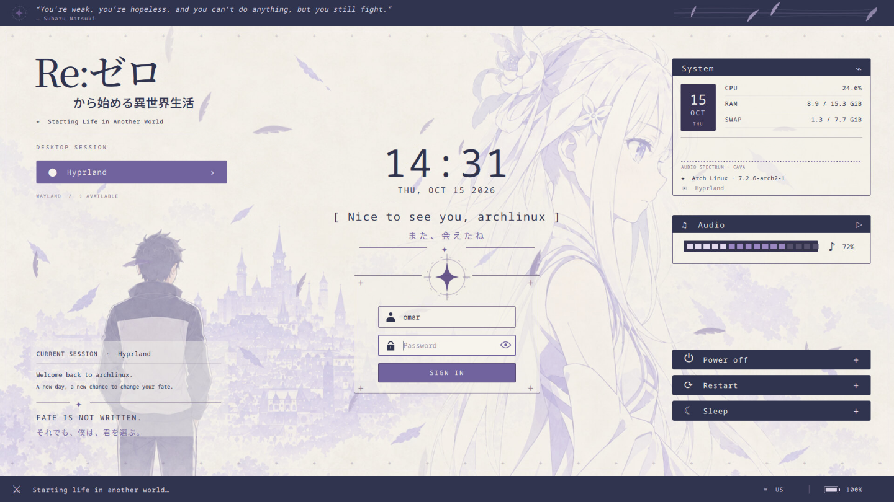
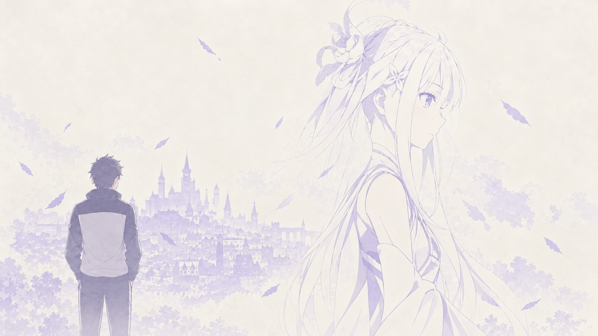

# Re:Zero — Another Beginning

An ivory-and-lavender **Qt 6 SDDM theme** with drifting feathers, gentle hair sway, a CAVA audio spectrum, and three matching wallpapers. Includes an interactive localhost preview of the actual QML scene.



## Permanent installation

These steps install **Re:Zero — Another Beginning as your login-screen theme** and keep it selected after reboot. The commands below target Arch Linux with Qt 6 SDDM. For other distributions, install equivalent Qt 6 packages and check their SDDM paths. You also need an installed desktop session, such as Hyprland or Plasma.

### 1. Install dependencies

```sh
sudo pacman -S --needed git sddm qt6-declarative qt6-multimedia qt6-svg \
  mesa ttf-jetbrains-mono noto-fonts-cjk
```

The installed theme does not require Python, noVNC, CAVA, or the browser preview service. Its compiled hair shader is included. SDDM must support `QtVersion=6`; use the Qt 6 greeter for the preview below.

### 2. Download the repository

Run this in the directory where you keep your projects, or enter your existing checkout:

```sh
git clone https://github.com/MrTr4p/rezero-sddm.git
cd rezero-sddm
```

### 3. Install the theme files

Run these commands from the repository root. Only `theme/` is installed; the project and browser demo stay in your checkout.

```sh
sudo install -d -m 0755 /usr/share/sddm/themes/rezero
sudo cp -R theme/. /usr/share/sddm/themes/rezero/
sudo chown -R root:root /usr/share/sddm/themes/rezero
sudo chmod -R u=rwX,go=rX /usr/share/sddm/themes/rezero
sudo sed -i 's|^TelemetryUrl=.*|TelemetryUrl=|' /usr/share/sddm/themes/rezero/theme.conf
```

The last command disables the optional browser-preview telemetry bridge in the installed copy. Login, session selection, artwork, and animations work independently of that bridge. CPU/RAM readings and the CAVA spectrum are unavailable unless you separately configure telemetry for the SDDM session. Audio playback also depends on audio access in the greeter session.

### 4. Preview the installed theme

From a terminal in your graphical desktop session, run:

```sh
QT_QPA_PLATFORM=xcb QT_QUICK_CONTROLS_STYLE=Basic QSG_RHI_BACKEND=opengl \
  sddm-greeter-qt6 --test-mode --theme /usr/share/sddm/themes/rezero
```

Check that the artwork, session choices, and login controls appear. Press **Ctrl+C in the launching terminal** to close the preview. The installed theme files remain in place.

This uses X11 or XWayland, including on a Wayland desktop such as Hyprland. [SDDM test mode](https://github.com/sddm/sddm/blob/v0.21.0/docs/THEMING.md#testing) does not authenticate, start a desktop, or execute power actions. A blank username, `localhost` greeting, or disabled power controls can occur without the display-manager connection. The browser demo's `test` password does not apply to the real login screen.

### 5. Select Re:Zero permanently

Create a dedicated SDDM configuration file. If `/etc/sddm.conf.d/99-rezero.conf` already exists, back it up before replacing it. If you already use `GreeterEnvironment` for other settings, retain those comma-separated entries alongside the two below.

```sh
sudo install -d -m 0755 /etc/sddm.conf.d
sudo tee /etc/sddm.conf.d/99-rezero.conf > /dev/null <<'EOF'
[Theme]
Current=rezero

[General]
GreeterEnvironment=QT_QUICK_CONTROLS_STYLE=Basic,QSG_RHI_BACKEND=opengl
EOF
sudo chmod 0644 /etc/sddm.conf.d/99-rezero.conf
```

**Check for existing overrides:** SDDM reads local snippets in `/etc/sddm.conf.d/`, then `/etc/sddm.conf`, which has higher priority. If that legacy file sets `[Theme] Current`, back it up and remove that conflicting key so `99-rezero.conf` can select the theme. Also check for a later-sorting snippet that selects another theme. If you configured a custom `ThemeDir`, either install `rezero` there or set `ThemeDir=/usr/share/sddm/themes` in the effective `[Theme]` section. Existing `GreeterEnvironment` overrides must also agree with your intended settings. See the [SDDM configuration reference](https://github.com/sddm/sddm/blob/v0.21.0/data/man/sddm.conf.rst.in).

For example, **only if `/etc/sddm.conf` exists and needs editing**:

```sh
sudo cp -a /etc/sddm.conf "/etc/sddm.conf.rezero-backup-$(date +%Y%m%d-%H%M%S)"
sudoedit /etc/sddm.conf
```

Keep your existing session, autologin, and display-server settings. Remove only conflicting keys you intend the new snippet to control, and keep the backup path for rollback.

### 6. Use it at the next boot

If SDDM is already enabled as your display manager, no service change is needed. For a new SDDM setup with **no other display manager enabled**, enable it for boot:

```sh
sudo systemctl enable sddm.service
```

If GDM, LightDM, or another display manager is enabled, follow your distribution's instructions to switch to SDDM first. Do not enable competing display managers.

Save your work, then reboot when ready:

```sh
systemctl reboot
```

The Re:Zero theme will appear at the next SDDM login screen and remain selected on subsequent boots. Sign in with your **normal Linux username and password**. If autologin is configured, SDDM can skip the login screen; disable autologin separately if you want to see the theme at boot. Restarting SDDM during a desktop session can end that session, so use the planned reboot above.

### Customize or update an installation

Edit the installed configuration with:

```sh
sudoedit /usr/share/sddm/themes/rezero/theme.conf
```

Set `Background` to one of the paths in [Wallpapers](#wallpapers), `Animations=false` to reduce motion, or `PreferredSession` to your desktop's `.desktop` filename from `/usr/share/wayland-sessions/` or `/usr/share/xsessions/`. Keep `TelemetryUrl=` empty unless you have configured a greeter-session bridge. Edit the installed `theme.conf` directly to clear telemetry; SDDM 0.21 ignores empty values in `theme.conf.user`.

To update, save any customized installed files, run `git pull --ff-only` in your checkout, and repeat step 3. That copy replaces `theme.conf`, so reapply your custom settings afterward. Step 5 only needs repeating if you want to change the selection or greeter environment.

### Restore your previous theme or uninstall

Remove the selection snippet first:

```sh
sudo rm -f /etc/sddm.conf.d/99-rezero.conf
```

Your earlier SDDM configuration will apply again; with no selected theme, SDDM uses its built-in fallback. If you edited `/etc/sddm.conf` or another snippet in step 5, restore the previous values from your backup as well. If `99-rezero.conf` existed before this installation, restore its saved copy instead of leaving it deleted. Make sure no remaining configuration selects `rezero`, then remove the installed theme:

```sh
sudo rm -rf -- /usr/share/sddm/themes/rezero
```

Reboot when ready. Removing the theme does not uninstall or disable SDDM. If the login screen fails to load, switch to a text console with **Ctrl+Alt+F3**, log in with your Linux account, and perform the same rollback steps there.

## Optional preview without installing

After installing the dependencies and downloading the repository, run this block from its root to preview a temporary copy. It leaves the system theme directory and selected login theme unchanged and removes the copy when you exit:

```sh
(
  set -eu
  test -f theme/Main.qml
  mkdir -p "$HOME/.local/share"
  theme_test_dir=$(mktemp -d "$HOME/.local/share/rezero-sddm-test.XXXXXX")
  trap 'rm -rf -- "$theme_test_dir"' EXIT
  trap 'exit 130' INT
  trap 'exit 143' TERM

  cp -R theme "$theme_test_dir/theme"
  sed -i 's|^TelemetryUrl=.*|TelemetryUrl=|' "$theme_test_dir/theme/theme.conf"

  QT_QPA_PLATFORM=xcb QT_QUICK_CONTROLS_STYLE=Basic QSG_RHI_BACKEND=opengl \
    sddm-greeter-qt6 --test-mode --theme "$theme_test_dir/theme"
)
```

Press **Ctrl+C in the launching terminal** to finish. Test mode does not validate a real login session, and telemetry is disabled in this copy.

## Try the interactive browser demo

The preview runs on Linux with a systemd user session. It displays the theme in an isolated Xvfb display through noVNC. It never authenticates against the operating system, launches a desktop, executes power operations, or modifies the installed SDDM configuration.

### Dependencies

On Arch Linux:

```sh
sudo pacman -S --needed base-devel git python python-pip \
  qt6-base qt6-declarative qt6-multimedia qt6-svg qt6-shadertools mesa \
  xorg-server-xvfb x11vnc cava ttf-jetbrains-mono noto-fonts-cjk
```

Install the Python [websockify bridge](https://github.com/novnc/websockify) in a user environment. noVNC 1.6.0 is already included, so no Node setup is needed.

```sh
git clone https://github.com/MrTr4p/rezero-sddm.git
cd rezero-sddm
python3 -m venv "$HOME/.local/share/rezero-sddm/venv"
"$HOME/.local/share/rezero-sddm/venv/bin/pip" install -r preview/requirements.txt
./start.sh
```

Open **http://localhost:8770/** once the service starts. Use your prefilled username and the demo password **`test`**. A different nonempty password demonstrates the error state. If no desktop session is installed, sign-in is disabled.

The bottom toolbar lets you switch wallpapers, reset the demo, and enter full screen. Wallpaper selection lasts for the current preview service session. Switching backgrounds resets the demo form.

```sh
./stop.sh
```

The transient `rezero-sddm-preview.service` does not start at boot. All network listeners bind to loopback: HTTP `8770`, WebSocket `6070`, and VNC `5970`; the isolated display is `:170`. Runtime logs are in `runtime/`, excluded from Git.

For startup problems, inspect `journalctl --user -u rezero-sddm-preview.service -n 50` and `runtime/login.log`. The launcher finds system tools automatically; custom locations can be supplied through `REZERO_X11VNC`, `REZERO_CAVA`, or `REZERO_WEBSOCKIFY_PYTHON` before running `./start.sh`.

## Wallpapers

All backgrounds use warm ivory paper, pale lavender linework, and clear space around the login controls. PNG files are 1672 × 941 pixels.

| Another Beginning | Royal Capital | Moonlit Forest |
| --- | --- | --- |
| [](theme/assets/background.png) | [](theme/assets/royal-capital.png) | [](theme/assets/moonlit-forest.png) |
| Original character artwork, with gentle hair sway | Stone bridges, castle spires, and wisteria at dawn | Frosted birches and a quiet path through ivory mist |

For the QML theme, set `Background` in [`theme/theme.conf`](theme/theme.conf) to one of:

```ini
Background=assets/background.png
# Background=assets/royal-capital.png
# Background=assets/moonlit-forest.png
```

The localhost toolbar selects its own background without editing this file. `HairSway=auto` applies the hair shader only to the original portrait; the landscape alternatives retain the drifting feathers and animated header. For a custom background, use `HairSway=false` unless its composition matches the original hair masks.

## Theme features

- 22 drifting feathers, a continuously flowing header ornament, a breathing compass, entrance transitions, and button hover effects. No floating star particles.
- Gentle localized hair sway on the original wallpaper; the face and city stay fixed. Set `Animations=false` for reduced ambient motion.
- Compact rectangular Sign in button, with the power controls aligned to the Current session section.
- Hostname greeting from `sddm.hostName`, username from `userModel.lastUser`, and desktop choices from `sessionModel`.
- Central clock; the footer shows keyboard layout and battery without repeating date or time.
- Password visibility, Enter to submit, Escape to clear, Caps Lock feedback, failure recovery, and capability-aware power confirmations.

The hair shader needs a Qt graphics backend such as OpenGL. Qt's software scenegraph shows a still portrait while retaining feather motion. Shader source and the compiled Qt shader package are in `theme/shaders/`; the launcher rebuilds the shader when needed.

## Audio and telemetry

The System panel uses **CAVA** to monitor the default audio output through PulseAudio or PipeWire's PulseAudio interface. It streams 64 frequency bars at 30 Hz. Silent output produces a flat spectrum; an unavailable CAVA process is shown as offline.

The Audio play button starts the included synthesized ambient loop. Volume and mute affect only the theme's audio. Audio starts paused. CPU, memory, swap, and battery values come from Linux system files through the local preview bridge.

`TelemetryUrl` in the source `theme/theme.conf` points to the optional localhost bridge. The permanent installation steps clear it in the installed copy. An installed SDDM greeter needs its own bridge and audio setup to provide the same telemetry and audio behavior as the browser demo; these services are not installed by the theme-copy commands. The login form and theme rendering do not depend on them.

## Development and validation

```sh
./preview/build.sh
./preview/test.sh
```

The interaction checks cover hostname and username, session selection, authentication validation, duplicate submissions, success/failure recovery, keyboard controls, audio controls, and simulated power actions. Session fixtures make the tests independent of the installed desktop. The browser preview is also checked with each wallpaper.

| Path | Purpose |
| --- | --- |
| `theme/` | Native QML SDDM theme, artwork, audio, and shaders |
| `preview/` | Mock SDDM context, localhost server, and browser viewer |
| `preview/vendor/novnc/` | Vendored noVNC source with its upstream licenses |
| `docs/artwork.md` | Image-generation prompts and asset provenance |

## Credits

An unofficial Re:Zero fan theme. Artwork was generated with the built-in imagegen tool; the original used the supplied design reference. Exact prompts are in [the artwork notes](docs/artwork.md). The ambient loop is synthesized audio, and the compass, feather, and input icons are code-native vectors.

noVNC and its bundled dependencies retain their [upstream licenses](preview/vendor/novnc/LICENSE.txt). API references: [SDDM theme API](https://github.com/sddm/sddm/blob/develop/docs/THEMING.md), [Qt ShaderEffect](https://doc.qt.io/qt-6/qml-qtquick-shadereffect.html), and [CAVA configuration](https://github.com/karlstav/cava/blob/master/example_files/config).
